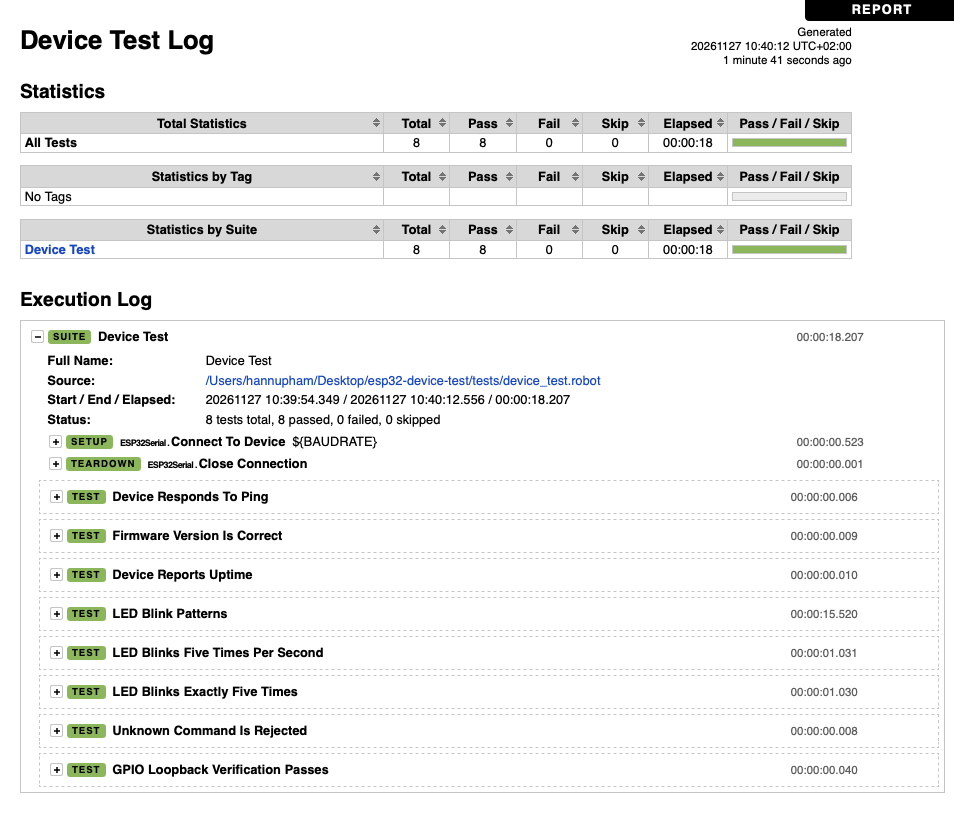
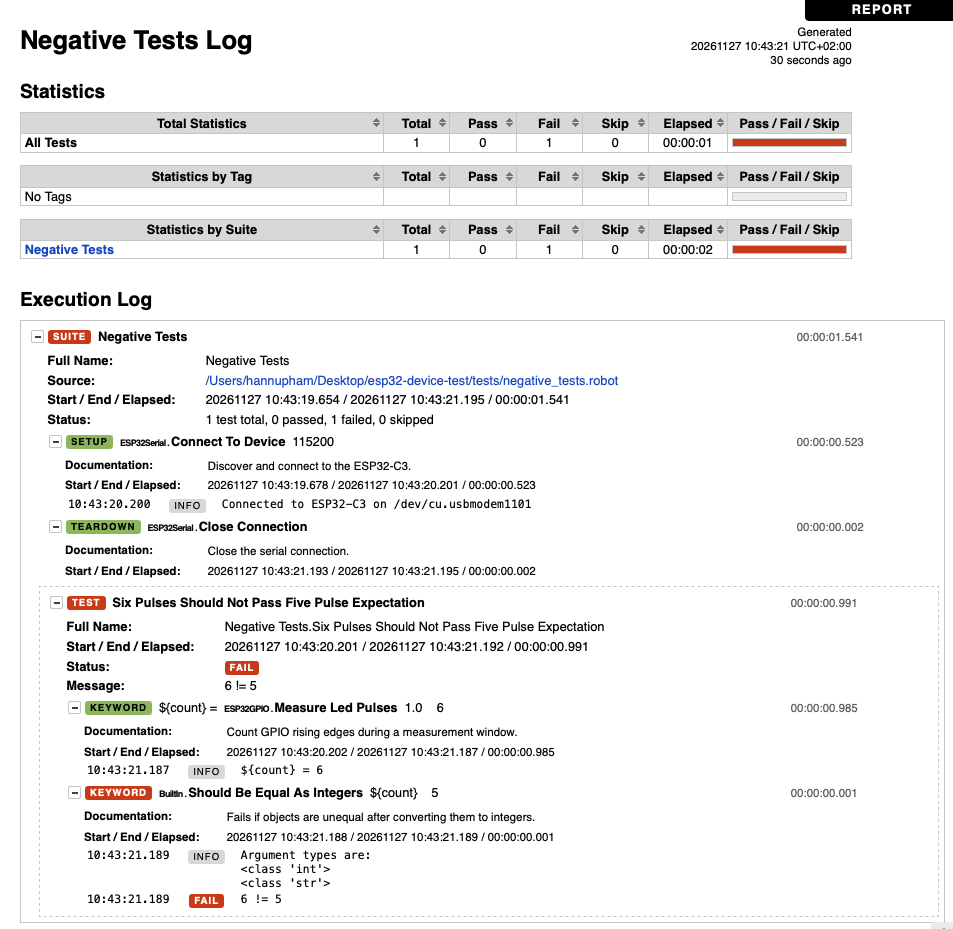

# ESP32 Device Test Automation

An embedded device testing project using **ESP32-C3, ESP-IDF, C++, Python and Robot Framework**.

The project demonstrates how to communicate with an embedded device over USB Serial/JTAG, control hardware through a command interface, and automate functional tests using Python and Robot Framework.

## Table of Contents

- [Overview](#overview)
- [Architecture](#architecture)
- [Hardware](#hardware)
  - [LED wiring](#led-wiring)
  - [GPIO loopback](#gpio-loopback)
- [Technologies](#technologies)
- [Firmware commands](#firmware-commands)
- [Project structure](#project-structure)
- [Setup](#setup)
  - [Requirements](#1-requirements)
  - [Install Python dependencies](#2-install-python-dependencies)
  - [Build and flash firmware](#3-build-and-flash-firmware)
  - [Run automated tests](#4-run-automated-tests)
- [Automated tests](#automated-tests)
- [Test results](#test-results)
  - [Positive test results](#positive-test-results)
  - [Negative test results](#negative-test-results)
- [Project objectives](#project-objectives)
- [Future improvements](#future-improvements)

## Overview

The ESP32-C3 runs custom C++ firmware that exposes a serial command interface. Python libraries communicate with the device over USB Serial/JTAG, while Robot Framework executes automated test cases and verifies device responses.

The physical test fixture includes an external LED connected to GPIO10 and a GPIO loopback connection between GPIO10 and GPIO3. This allows the test suite to exercise hardware control and verify electrical signal transitions.

## Architecture

```text
Robot Framework
      |
      v
Python Test Libraries
      |
      v
USB Serial/JTAG
      |
      v
ESP32-C3 Firmware (C++)
      |
      v
    GPIO10
      |
      +---- 220 Ω resistor ---- LED ---- GND
      |
      +------------------------ GPIO3
                                INPUT
                             (Loopback)
```

## Hardware

- Seeed Studio XIAO ESP32-C3
- External LED
- 220 Ω current-limiting resistor
- USB cable
- Jumper wires

### LED wiring

Connect the LED in series with the current-limiting resistor:

```text
GPIO10 ---- 220 Ω resistor ---- LED anode (+)
                                  LED cathode (-)
                                      |
                                     GND
```

The LED is active-high:

- GPIO HIGH: LED ON
- GPIO LOW: LED OFF

### GPIO loopback

GPIO10 is also connected directly to GPIO3 using a jumper wire.

| GPIO | Configuration | Purpose |
| --- | --- | --- |
| GPIO10 | OUTPUT | Controls the LED and generates test signals |
| GPIO3 | INPUT | Reads the GPIO10 loopback signal |

The firmware toggles GPIO10 and reads GPIO3 to verify the expected electrical logic levels.

This verifies GPIO signal transitions, not the actual optical output of the LED.

## Technologies

| Technology | Purpose |
| --- | --- |
| C++ | Embedded firmware |
| ESP-IDF 6.0 | Firmware development framework |
| ESP32-C3 | Target hardware |
| USB Serial/JTAG | Device communication |
| Python | Test automation and serial communication |
| PySerial | USB serial interface |
| Robot Framework | Automated testing |

## Firmware commands

| Command | Expected response | Function |
| --- | --- | --- |
| `PING` | `PONG` | Communication check |
| `GET_VERSION` | `VERSION:1.0.0` | Firmware version |
| `GET_UPTIME` | `UPTIME:<milliseconds>` | Device uptime |
| `LED ON` | `LED:ON` | Switch LED on |
| `LED OFF` | `LED:OFF` | Switch LED off |
| `GET_LED` | `LED:ON` or `LED:OFF` | Read LED state |
| `VERIFY_LOOPBACK` | `LOOPBACK:PASS/FAIL` | Verify GPIO feedback |
| `MEASURE_PULSES <duration> <frequency>` | `PULSES:<count>` | Generate pulses and count rising edges |
| `COUNT_BLINKS <cycles>` | `BLINKS:<count>` | Generate and count blink cycles |
| Invalid command | `ERROR:UNKNOWN_COMMAND` | Error handling |

## Project structure

```text
esp32-device-test/
├── firmware/
│   ├── CMakeLists.txt
│   └── main/
│       ├── CMakeLists.txt
│       └── main.cpp
├── libraries/
│   ├── ESP32Serial.py
│   └── ESP32GPIO.py
├── tests/
│   ├── device_test.robot
│   └── negative_tests.robot
├── img/
│   ├── devicetest.png
│   └── negativetest.png
├── results/
├── requirements.txt
├── .gitignore
└── README.md
```

## Setup

### 1. Requirements

- ESP-IDF 6.0
- Python 3
- Robot Framework
- PySerial

### 2. Install Python dependencies

From the project root:

```bash
python3 -m venv .venv
source .venv/bin/activate
pip install -r requirements.txt
```

### 3. Build and flash firmware

Activate the ESP-IDF environment, then:

```bash
cd firmware

idf.py set-target esp32c3
idf.py build
idf.py -p <port> flash
```

The serial device path may differ depending on your operating system and USB connection.

### 4. Run automated tests

Return to the project root and activate the Python virtual environment.

Run the positive test suite:

```bash
robot --pythonpath libraries -d results tests/device_test.robot
```

Run the negative test separately:

```bash
robot --pythonpath libraries -d results tests/negative_tests.robot
```

Robot Framework generates HTML and XML test reports in the `results/` directory.

## Automated tests

The positive test suite currently covers:

- Serial communication and device response
- Firmware version verification
- Uptime reporting
- LED ON/OFF control
- LED state reporting
- LED blink patterns
- Pulse generation and rising-edge counting
- GPIO loopback verification
- Invalid command handling

## Test results

The tests were executed against the physical Seeed Studio XIAO ESP32-C3.

### Positive test results

**8 tests passed, 0 failed.**

The positive test suite verifies serial communication, firmware information, uptime, LED control, pulse counting, command error handling and GPIO loopback behaviour.



### Negative test results

The negative test deliberately supplies an incorrect expected pulse count. It requests six pulses but expects five.

Robot Framework correctly detects the mismatch:

```text
FAIL
6 != 5
```

This is an intentional assertion failure demonstrating that the test framework detects unexpected results.



## Project Objectives

This project demonstrates practical application of embedded systems and software testing skills through a working hardware-in-the-loop test environment.

Key areas demonstrated:

- Embedded firmware development and testing
- Hardware-software integration and GPIO validation
- USB Serial/JTAG communication
- Python-based test automation
- Robot Framework test design and execution
- Functional testing, negative testing and error handling
- Hardware signal verification through GPIO loopback and pulse counting

## Future improvements

- Add CI integration with Jenkins
- Improve serial communication error handling
- Improve pulse-count synchronization and timing accuracy
- Expand automated hardware test coverage
- Add configurable test parameters
- Explore optical LED verification using an external light sensor

---

**Author:** Hannu  
